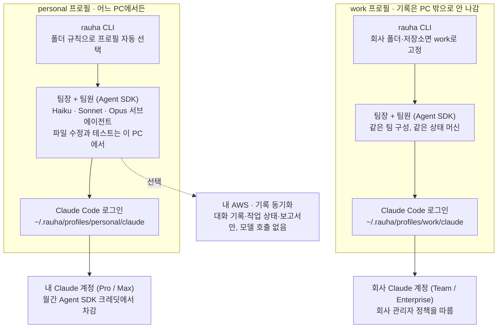
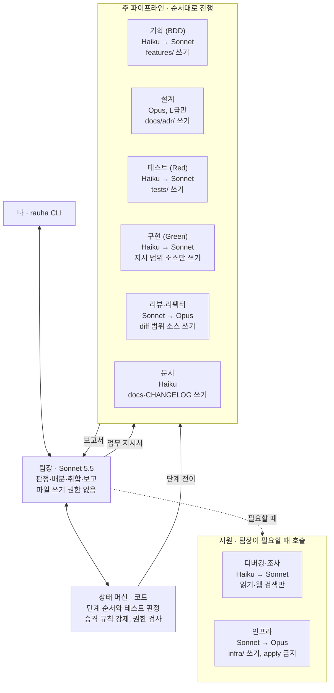
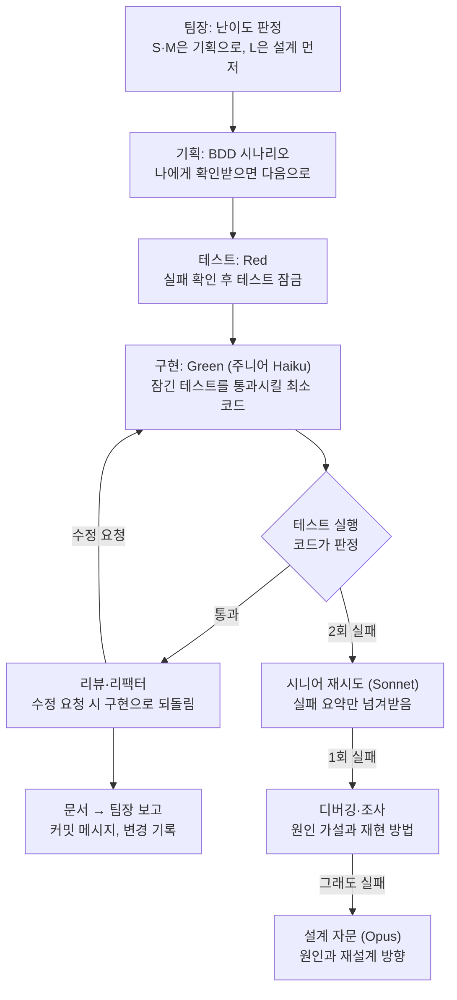

# 클로드 팀 구성 설계서

2026-10-24 · 김평화

> 원본: Claude Docs의 「클로드 팀 구성 설계서」. 이 파일은 저장소용 사본이며, 가칭 `crew`를 실제 이름 `rauha`로 바꿨다.

## 개요

팀장 1명과 팀원 9개 팀으로 구성하고, 쉬운 일은 Haiku 5.5 주니어가 처리하고 테스트가 실패할 때만 상위 모델로 올리는 구조다. 나는 팀장하고만 대화하고, 팀원은 팀장에게만 보고한다.

| 구분 | 팀 | 호출 방식 |
| --- | --- | --- |
| 지휘 | 팀장 | 모든 요청의 입구이자 출구 |
| 주 파이프라인 | 기획, 설계, 테스트, 구현, 리뷰·리팩터, 문서 | 정해진 순서대로 자동 진행 |
| 지원 | 디버깅·조사, 인프라 | 팀장이 필요할 때만 호출 |

**공통 원칙 4가지**

1. **작게 쪼갠다.** 팀장은 업무를 팀원 하나가 파일 몇 개 안에서 끝낼 크기로 나눈다. 토큰 수가 그대로 소비량이 되므로, 구독 한도를 쓰든 API 요율로 과금되든 작게 쪼개는 쪽이 항상 유리하다. 세 등급 모두 컨텍스트는 1M이지만, 입력이 길수록 느리고 비싸므로 작게 넘기는 원칙은 그대로다.
2. **정해진 양식으로만 보고한다.** 팀원은 작업 과정이 아니라 짧은 보고서만 팀장에게 올린다. 팀장 컨텍스트가 줄어드는 것이 모델 선택보다 절약 효과가 크다.
3. **판정은 코드가 한다.** 파이프라인 순서와 테스트 통과 여부는 오케스트레이터 코드(상태 머신)가 강제하고, 모델은 판단과 작성만 맡는다.
4. **각 등급의 현행 모델만 쓴다.** 구형을 쓸 이유가 없다. 2026년 10월 기준 현행 모델은 Haiku 5.5, Sonnet 5.5, Opus 5.5다(Haiku 4.5, Sonnet 5, Opus 5는 legacy). 난이도 차이는 모델 등급(Haiku → Sonnet → Opus)과 effort 설정으로 둔다. 세 모델 모두 `effort`를 쓸 수 있다.

**모델 요금 기준** (100만 토큰당, 2026년 10월 기준 · API 요율로 과금될 때 적용)

| 모델 | 모델 ID | 입력 | 출력 | 컨텍스트 | 이 팀에서 쓰는 곳 |
| --- | --- | --- | --- | --- | --- |
| Haiku 5.5 | `claude-haiku-5-5` | $0.10부터 | $0.50부터 | 1M | 주니어 전반, 문서 |
| Sonnet 5.5 | `claude-sonnet-5-5` | $2 | $10 | 1M | 팀장, 시니어 전반 |
| Opus 5.5 | `claude-opus-5-5` | $4 | $20 | 1M | 설계, 최종 자문 |

출처: [Models overview](https://platform.claude.com/docs/en/about-claude/models/overview) (2026-10-25 확인). 세 ID 모두 Pro 플랜 로그인에서 호출되는 것을 확인했다(2026-10-25, `claude -p --model <id>`). 승격 사다리의 절감 효과는 주니어가 몇 번째 시도에서 성공하는지에 달려 있으므로, 실제 절감폭은 구현 순서 2단계에서 토큰 사용량을 기록해 확인한다.

**측정 (2026-10-25, `bench --compare`, 프롬프트 434a19e1):** S급 5개 요청에서 사다리(haiku부터)와 구현 sonnet 고정이 모두 5/5 첫 시도 성공했고, 추정 비용은 사다리 $0.173, sonnet 고정 $0.384로 사다리가 약 45%였다(평균 시간 1:16 vs 1:17). 이 5개에서는 haiku가 전부 첫 시도에 성공해 **승격은 한 번도 일어나지 않았다** — 승격이 일어났을 때의 비용은 아직 측정하지 못했다. M급 2개(coupon, quantity-limit)는 실행 도중 구독 세션 한도에 걸려 무효다.

## 전체 아키텍처

팀장과 팀원은 각 PC 안에서, 그 PC에 로그인된 프로필의 Claude 계정으로 돈다. 서버가 대신 모델을 부르는 구조는 없고, AWS는 personal 프로필의 기록 동기화에만 선택적으로 쓴다.

### 서비스 아키텍처



프로필마다 Claude Code 설정 폴더가 달라서 두 계정의 로그인과 기록이 섞이지 않는다. 동기화 서버는 모델을 호출하지 않고 대화 기록·작업 상태·보고서만 저장한다. 서버는 ECS on Fargate의 작은 API(프라이빗 서브넷, 앞단 ALB, Cognito 인증)로 두고, 저장소는 DynamoDB와 S3를 VPC 엔드포인트로 붙인다. VPC 구조 공부는 이 서버와, 팀이 만드는 앱의 배포 환경에서 함께 한다.

### 오케스트레이션 팀 아키텍처



팀원끼리는 서로 대화하지 않고, 모든 지시와 보고는 팀장을 거친다. 각 팀원 상자의 마지막 줄은 상태 머신이 강제하는 쓰기 권한이다.

## 팀장 (오케스트레이터)

팀장은 Sonnet 5.5로 두고, 직접 코드를 쓰지 않고 판정·배분·취합·보고만 한다. 매 턴 호출되는 자리라 Opus를 쓰면 절약 효과가 사라진다.

| 항목 | 내용 |
| --- | --- |
| 모델 | Sonnet 5.5 (effort: medium) |
| 입력 | 나의 요청, 팀원 보고서, 상태 머신의 현재 단계 |
| 출력 | 업무 지시서(팀원에게), 최종 보고(나에게) |
| 권한 | 파일 읽기, 서브에이전트 호출. 파일 쓰기·셸 실행 없음 |
| 금지 | 직접 구현, 테스트 수정, 팀원 보고서 원문을 그대로 나에게 전달 |

**난이도 판정 기준**

| 등급 | 기준 | 처리 |
| --- | --- | --- |
| S | 파일 1–2개, 기존 패턴 반복, 외부 연동 없음 | 기획·테스트·구현 모두 주니어, 설계 생략 |
| M | 파일 3–5개, 새 함수·컴포넌트 추가, 모듈 하나 안 | 주니어로 시작, 승격 규칙 적용 |
| L | 모듈 간 변경, 새 아키텍처, 인증·결제·데이터 스키마 | 설계(Opus) 먼저, 기획·테스트는 시니어 |

인증, 권한, 암호화, 결제, 개인정보가 걸린 작업은 파일 수와 상관없이 L로 올린다.

**업무 지시서 양식** (팀장 → 팀원)

```markdown
## 업무: <한 줄 목표>
- 등급: S / M / L
- 범위: <건드려도 되는 파일·디렉터리>
- 입력: <시나리오 ID, 테스트 파일, 설계 문서 경로>
- 완료 조건: <어떤 테스트가 통과하면 끝인지>
- 금지: <건드리면 안 되는 것>
```

## 기획 (BDD)

기획 팀은 내 요청을 Given/When/Then 시나리오로 바꾸고, 그 시나리오를 나에게 확인받는 것으로 끝난다. 여기서 확정된 시나리오가 이후 모든 팀의 기준이 된다.

| 항목 | 내용 |
| --- | --- |
| 주니어 | Haiku 5.5: 요청이 명확하고 S·M급일 때 |
| 시니어 | Sonnet 5.5: L급이거나 요청이 모호할 때 |
| 입력 | 나의 원문 요청, 관련 코드 요약 |
| 출력 | `.feature` 파일(Gherkin), 확인 질문 최대 3개 |
| 권한 | 코드 읽기, `features/` 디렉터리 쓰기 |
| 금지 | 구현 방법 제안, 시나리오에 없는 기능 추가 |
| 승격 | 내가 시나리오를 2번 반려하면 시니어로 |

시나리오에는 정상 경로 1개 이상, 예외 경로 1개 이상을 반드시 넣는다. 예외 경로가 없는 시나리오는 상태 머신이 다음 단계로 넘기지 않는다.

```gherkin
Feature: 로그인 실패 제한
  Scenario: 5회 연속 실패 시 계정 잠금
    Given 사용자가 4번 연속 로그인에 실패했다
    When 틀린 비밀번호로 한 번 더 로그인한다
    Then 계정이 15분간 잠긴다
    And "잠시 후 다시 시도하세요" 메시지가 보인다
```

## 설계

설계 팀은 L급 작업에서만 호출되고, 코드 대신 짧은 설계 노트(ADR)를 남긴다. 가장 비싼 모델이라 호출 횟수를 줄이는 것이 핵심이다.

| 항목 | 내용 |
| --- | --- |
| 모델 | Opus 5.5 (주니어 없음) |
| 호출 시점 | L급 판정 직후, 또는 시니어 구현이 실패해 자문이 필요할 때 |
| 입력 | 확정된 시나리오, 관련 모듈 구조 요약(전체 코드 아님) |
| 출력 | ADR 1개: 결정, 대안 2개와 기각 이유, 인터페이스 시그니처, 영향받는 파일 목록 |
| 권한 | 코드 읽기, `docs/adr/` 쓰기 |
| 금지 | 구현 코드 작성, 시나리오 변경 |

자문 모드로 불렸을 때는 새 설계가 아니라 "왜 실패했는지와 무엇을 바꿔야 하는지"만 3–5줄로 답한다. 이 답을 받은 팀장은 디버깅 팀이나 시니어 구현에게 다시 배분한다.

## 테스트 (TDD Red)

테스트 팀은 시나리오 하나당 실패하는 테스트를 쓰고, 실제로 실패하는 것을 실행해서 확인해야 끝난다. 구현 팀과 반드시 분리한다.

| 항목 | 내용 |
| --- | --- |
| 주니어 | Haiku 5.5: S·M급, 단위 테스트 |
| 시니어 | Sonnet 5.5: L급, 통합 테스트, 비동기·동시성 |
| 입력 | `.feature` 파일, 설계 노트(있으면), 대상 모듈의 공개 인터페이스 |
| 출력 | 테스트 파일, 실행 결과(실패 로그) |
| 권한 | `tests/` 쓰기, 테스트 명령 실행 |
| 금지 | 소스 코드 수정, 통과하는 테스트 제출 |
| 승격 | 테스트가 컴파일·실행 자체가 안 되는 상태로 2번 제출하면 시니어로 |

상태 머신은 테스트가 "올바른 이유로" 실패하는지 확인한다. 문법 오류나 import 실패로 깨지면 Red로 인정하지 않고 되돌린다. 테스트 이름은 시나리오 ID를 포함해서, 나중에 어느 시나리오가 깨졌는지 바로 추적되게 한다.

Red 단계가 끝나면 테스트 파일은 잠긴다. 이후 단계에서 테스트를 바꾸려면 팀장이 나에게 사유를 보고하고 승인을 받아야 한다.

## 구현 (TDD Green)

구현 팀은 잠긴 테스트를 통과시키는 최소한의 코드만 쓴다. 승격 사다리가 가장 길게 걸린 팀이라, 대부분의 비용 절약이 여기서 나온다.

| 항목 | 내용 |
| --- | --- |
| 주니어 | Haiku 5.5: 모든 S·M급의 첫 시도 |
| 시니어 | Sonnet 5.5: 주니어 2회 실패 후, 또는 L급 첫 시도 |
| 자문 | 설계(Opus 5.5): 시니어도 2회 실패했을 때 |
| 입력 | 업무 지시서, 테스트 파일(읽기 전용), 설계 노트 |
| 출력 | 변경된 소스 파일, 테스트 실행 결과 |
| 권한 | 지시서에 적힌 범위의 소스 쓰기, 테스트 실행 |
| 금지 | 테스트 파일 수정, 범위 밖 파일 수정, 테스트 건너뛰기(skip) |

승격할 때는 이전 시도의 전체 대화를 넘기지 않는다. "무엇을 시도했고, 어떤 테스트가 어떤 메시지로 실패했는지"만 5줄 이내로 요약해서 넘긴다. 시니어가 같은 실수를 반복하지 않게 하면서도 컨텍스트는 작게 유지한다.

상태 머신은 구현 팀의 변경 diff에 `tests/` 경로가 있으면 자동으로 거부한다. 범위 밖 파일 변경도 같은 방식으로 막는다.

## 리뷰·리팩터 (TDD Refactor)

리뷰·리팩터 팀은 통과한 코드를 정리하고 품질·보안을 점검하며, 리팩터 후 테스트가 다시 통과해야 끝난다. 주니어 없이 Sonnet부터 시작한다. 리뷰를 Haiku에 맡기면 놓치는 것이 많아 오히려 비싸진다.

| 항목 | 내용 |
| --- | --- |
| 기본 | Sonnet 5.5 |
| 상위 | Opus 5.5: 인증·권한·암호화·결제·개인정보 관련 변경일 때 |
| 입력 | 이번 작업의 diff, 시나리오, 설계 노트 |
| 출력 | 리팩터된 코드, 리뷰 결과(통과 / 수정 요청 / 보안 경고) |
| 권한 | diff 범위의 소스 쓰기, 테스트·린트·정적 분석 실행 |
| 금지 | 동작 변경, 테스트 수정, diff 밖 대규모 정리 |

**점검 항목**

- 중복 코드, 불필요한 추상화, 죽은 코드
- 입력 검증, 에러 처리, 비밀값 하드코딩
- 이름과 구조가 시나리오의 용어와 맞는지
- 린트·정적 분석(eslint, semgrep 등) 결과

"수정 요청"이 나오면 상태 머신은 구현 단계로 되돌린다. 같은 작업에서 수정 요청이 2번 나오면 팀장이 나에게 보고한다.

## 디버깅·조사 (지원)

디버깅·조사 팀은 파이프라인 밖에 있고, 팀장이 원인을 좁혀야 할 때나 외부 정보가 필요할 때만 부른다. Opus 자문 전에 이 팀을 먼저 거치면 비싼 호출을 줄일 수 있다.

| 항목 | 내용 |
| --- | --- |
| 주니어 | Haiku 5.5: 문서·라이브러리 버전 조회, 에러 메시지 검색 |
| 시니어 | Sonnet 5.5: 실패 원인 분석, 재현 스크립트 작성 |
| 호출 시점 | 시니어 구현 1회 실패 후, 모르는 라이브러리·API를 다룰 때 |
| 입력 | 실패 로그, 관련 파일 목록, 질문 한 줄 |
| 출력 | 원인 가설 1–3개(근거 포함), 참고 링크, 재현 방법 |
| 권한 | 코드 읽기, 웹 검색, 문서 조회(context7 등), 임시 스크립트 실행 |
| 금지 | 소스·테스트 수정 |

조사 결과는 근거 없이 단정하지 않는다. 가설마다 "확인됨 / 추정"을 표시하고, 확인 방법을 함께 적는다.

## 인프라 (지원)

인프라 팀은 AWS 리소스를 IaC 코드로만 다루고, 실제 배포(apply)는 항상 내 승인 후에만 실행한다. 클라우드 리소스는 되돌리기 어렵고 비용이 바로 나가기 때문이다.

| 항목 | 내용 |
| --- | --- |
| 모델 | Sonnet 5.5 (주니어 없음) |
| 상위 | Opus 5.5: VPC·서브넷·보안그룹 구조를 새로 설계할 때 |
| 담당 범위 | ECS on Fargate, VPC(퍼블릭/프라이빗 서브넷), ALB, 보안그룹, IAM, VPC 엔드포인트 |
| 입력 | 요구사항, 현재 IaC 코드, 설계 노트 |
| 출력 | IaC 변경(CDK 또는 Terraform), plan/diff 결과, 예상 월 비용 변화 |
| 권한 | `infra/` 쓰기, plan·synth 실행 |
| 금지 | apply·deploy 실행, 0.0.0.0/0 인바운드 허용, IAM `*` 권한 |

**반드시 지킬 구조 원칙**

- ECS 태스크는 프라이빗 서브넷, 퍼블릭 IP 없음
- 퍼블릭에 노출되는 것은 ALB(또는 API Gateway) 하나
- S3는 게이트웨이 엔드포인트로 연결
- 보안그룹은 "ALB → 태스크"처럼 보안그룹 간 참조로 연다

테스트 단계에서는 정책 검사 도구(cfn-nag, checkov 등)를 테스트 대신 쓴다. 정책 위반이 있으면 Red로 취급한다.

## 문서

문서 팀은 Haiku 5.5 하나로 충분하고, 파이프라인 마지막에 변경 사항을 기록한다. 입력이 이미 정리된 보고서라 상위 모델이 필요 없다.

| 항목 | 내용 |
| --- | --- |
| 모델 | Haiku 5.5 (effort: low) |
| 입력 | 각 팀 보고서, 최종 diff 요약, 시나리오 |
| 출력 | 커밋 메시지, CHANGELOG 항목, 필요할 때 README·ADR 갱신 |
| 권한 | `docs/`, `CHANGELOG.md`, `README.md` 쓰기 |
| 금지 | 소스·테스트 수정, 보고서에 없는 내용 추가 |

커밋 메시지는 Conventional Commits 형식으로 쓰고, 본문에 시나리오 ID를 넣는다. 이렇게 하면 나중에 "이 코드가 어떤 요구사항 때문에 생겼는지"를 git log만으로 추적할 수 있다.

## 승격 규칙과 보고서 양식

모든 전이는 상태 머신 코드가 결정한다. 모델이 "끝났다"고 말해도 테스트가 통과하지 않으면 다음 단계로 넘어가지 않는다.



승격 경로의 어느 단계에서든 테스트가 통과하면 리뷰·리팩터로 돌아오고, 설계 자문까지 실패하면 팀장이 작업을 멈추고 나에게 보고한다.

**팀원 보고서 양식** (팀원 → 팀장, 모든 팀 공통)

```markdown
## 보고: <업무 한 줄>
- 결과: 완료 / 실패 / 판단 필요
- 한 일: <3줄 이내>
- 바뀐 파일: <경로 목록>
- 테스트: <통과 n / 실패 n, 실패한 테스트 이름>
- 남은 문제: <없으면 "없음">
- 팀장 판단 필요: <질문 1개 또는 "없음">
```

보고서는 300토큰을 넘기지 않는다. 넘으면 상태 머신이 같은 모델에게 요약을 다시 요청한다.

## 계정 분리 (회사 / 개인)

계정은 Claude Code 로그인 자체를 프로필별로 나눈다. 프로필마다 전용 Claude Code 설정 폴더(`CLAUDE_CONFIG_DIR`)를 두고, 팀장과 팀원은 그 폴더의 로그인으로 지금 이 PC에서만 실행된다.

| 항목 | personal (개인) | work (회사) |
| --- | --- | --- |
| 로그인 | 내 Claude 계정 (Pro / Max) | 회사 Claude 계정 (Team / Enterprise) |
| 설정 폴더 | `~/.rauha/profiles/personal/claude` | `~/.rauha/profiles/work/claude` |
| 사용량 | 내 플랜의 월간 Agent SDK 크레딧 | 회사 플랜 정책(관리자 확인 필요) |
| 기록 저장 | 로컬 + 선택적으로 내 AWS에 동기화 | 로컬만 |
| 자동 선택 경로 | `~/dev/**` | `~/work/**`, 회사 Git 조직의 저장소 |

**동작 방식**

1. `rauha`를 실행하면 프로필을 정한다.
2. 그 프로필의 설정 폴더를 `CLAUDE_CONFIG_DIR`로 지정한 채 Agent SDK(런타임은 Claude Code)를 띄운다.
3. 처음 한 번은 `rauha login --profile work`로 해당 폴더에 Claude Code 로그인(브라우저 인증)을 한다.

rauha는 로그인 토큰을 직접 읽거나 다른 곳으로 옮기지 않는다. 토큰은 Claude Code 설정 폴더 안에만 있고, 집 PC와 회사 PC는 각자 따로 로그인한다.

**설정 파일 예시** (`~/.rauha/config.toml`)

```toml
[profiles.personal]
claude_config_dir = "~/.rauha/profiles/personal/claude"
sync = "aws"        # 개인 프로필만 동기화 허용

[profiles.work]
claude_config_dir = "~/.rauha/profiles/work/claude"
sync = "none"       # 회사 기록은 PC 밖으로 나가지 않음

[[match]]
path = "~/work/**"
profile = "work"

[[match]]
git_remote = "github.com/my-company/*"
profile = "work"
```

**프로필이 정해지는 순서**

1. 명령어 옵션 `rauha --profile work`
2. 환경 변수 `RAUHA_PROFILE`
3. `[[match]]` 규칙(폴더 경로 → Git 원격 주소 순)
4. 기본값 personal

**안전장치**

- 회사 규칙에 걸리는 폴더에서 personal 프로필로 실행하면 시작을 막는다. 반대도 마찬가지다.
- 프롬프트와 상태 줄에 항상 `[work]` / `[personal]` 배지를 띄운다.
- `rauha whoami`로 현재 프로필, 로그인한 계정, 설정 폴더 위치를 확인한다.
- 회사 계정으로 Agent SDK를 써도 되는지는 회사 관리자 정책을 먼저 확인한다.

**정책 근거**: Agent SDK 문서는 사전 승인 없이 서드파티 개발자가 자기 제품에 claude.ai 로그인이나 구독 한도를 제공하는 것을 허용하지 않고, 그런 경우 API 키 인증을 쓰라고 명시한다. 내 PC에서 내 로그인으로 혼자 쓰는 것은 "제품에 로그인을 제공"하는 경우가 아니라고 보고 이 구조를 택했다. rauha를 남에게 배포하게 되면 그때는 API 키 경로가 필수다. 어느 경우든 구독 토큰을 서버로 옮겨 대신 호출하는 구조는 쓰지 않는다. ([Agent SDK 문서](https://code.claude.com/docs/en/agent-sdk))

**과금 경로** (2026-10-25 확인): Pro 플랜 로그인으로 `claude -p --model <id>`가 Haiku 5.5 · Sonnet 5.5 · Opus 5.5 모두 정상 동작한다. 다만 이 사용분이 구독 한도에서 빠지는지 별도 크레딧에서 빠지는지는 **확인하지 못했다**. 2026년 6월 15일 예정이던 Agent SDK 크레딧 분리는 보류됐고 10월 7일부터 Max·Team에만 월간 API 크레딧이 붙는 것으로 바뀌었다는 2차 정보가 있으나, 공식 문서로 확인하지 못했다. 실제 소비 경로는 구현 순서 2단계의 사용량 기록으로 확인한다.

**확인 (2026-10-25):** rauha(Agent SDK)로 쓴 사용량은 Pro 구독의 세션 한도에서 빠진다. bench 14회 실행 도중 모든 팀원 호출이 `You've hit your session limit · resets 5:40pm (Asia/Seoul)`로 실패했다. 별도 크레딧으로 넘어가지 않았다.

## CLI 실행 방식과 현재 코드 위치 파악

이 툴은 터미널 CLI 하나로 만들고, VS Code 확장은 만들지 않는다. `claude`나 `kiro-cli`처럼 아무 폴더에서 `rauha`를 치면 그 폴더가 작업 대상이 되고, 팀장과 대화가 바로 시작된다.

**기술 선택**

| 항목 | 선택 | 이유 |
| --- | --- | --- |
| 언어 | TypeScript (Node.js) | Claude Agent SDK의 TypeScript 패키지를 그대로 사용 |
| 패키지 관리 | Yarn 4 (workspaces 모노레포) | 패키지별 분리, 하나의 lockfile |
| 에이전트 런타임 | Claude Agent SDK (내부적으로 Claude Code) | 구독 로그인, 도구 실행, 서브에이전트별 모델 지정이 이미 있음 |
| 터미널 UI | Ink (React 기반 CLI UI) | 스트리밍 출력, 상태 줄, 팀별 진행 표시 |
| 배포 | 전역 설치, `bin`에 `rauha` 등록 | 어느 폴더에서나 바로 실행 |

**명령어**

- `rauha` : 대화형 모드. 현재 폴더가 작업 범위가 된다.
- `rauha -p "로그인 실패 제한 추가해줘"` : 한 번 실행하고 결과만 출력.
- `yarn test 2>&1 | rauha -p "고쳐줘"` : 파이프 입력을 그대로 업무로 받는다.
- `rauha login --profile work`, `rauha whoami` : 프로필별 로그인과 확인.
- 대화 중 명령어: `/profile`, `/status`(현재 단계·승격 상황), `/usage`(팀별 사용량), `/team`(팀원과 모델), `/open`(파일을 에디터로 열기)

**"지금 보고 있는 코드" 파악 방법**

확장 없이 터미널에서 얻을 수 있는 신호를 우선순위대로 쓴다.

| 우선순위 | 신호 | 알 수 있는 것 |
| --- | --- | --- |
| 1 | 대화 속 직접 지정 | `@src/auth/login.ts:42`, `@src/auth/` 같은 파일·줄·폴더 참조 |
| 2 | 파이프로 받은 출력 | 테스트·빌드 에러 속 `파일:줄` 위치 |
| 3 | 실행한 위치 | 현재 폴더. 모노레포 하위 패키지에서 실행하면 그 패키지만 범위로 |
| 4 | Git | 브랜치, 수정 중인 파일(`git status`), 바뀐 줄 범위(`git diff`) |
| 5 | 파일 시스템 | 최근에 저장된 파일 순서 |

`rauha`를 시작하면 첫 줄에 지금 잡은 위치를 한 줄로 보여준다. 예: `[personal] ~/dev/app (main) · 수정 중 3개 · 최근 저장 src/auth/login.ts`. 틀렸으면 `@`로 바로 고쳐 지정한다.

반대 방향도 지원한다. 팀장 보고에 나오는 `파일:줄`은 터미널 하이퍼링크로 출력해서, VS Code 내장 터미널에서는 클릭하면 그 위치로 바로 이동한다. `/open`은 `$EDITOR`(예: `code -g`)로 파일을 연다.

팀장은 이 정보를 매 요청에 통째로 넣지 않는다. 경로·줄 번호·변경 범위만 넣고, 파일 내용이 필요하면 팀원이 도구로 직접 읽는다. 커서 위치까지 자동으로 필요해지면 그때 VS Code 보조 확장을 추가 단계로 붙인다.

## 개발 규칙: rauha 자체 vs rauha가 일하는 프로젝트

두 가지를 구분한다.

- **rauha 자체를 만들 때**: DDD 구조로 개발하되, 로직은 엔티티 메서드와 DTO 메서드에 둔다. 서비스는 이 메서드들을 순서대로 부르는 얇은 조정자다. 자세한 규칙은 [`docs/conventions/ddd-entity-dto.md`](../conventions/ddd-entity-dto.md)에 있다.
- **완성된 rauha로 다른 프로젝트를 개발할 때**: rauha는 특정 스타일을 강요하지 않는다. 팀원 프롬프트는 스타일 중립으로 두고, 대상 프로젝트의 `CLAUDE.md`·린트 설정·기존 코드 패턴을 먼저 읽고 그 방식을 따른다. 프로젝트마다 원하는 방식은 그 프로젝트의 `CLAUDE.md`에 적는다.

## 구현 순서

팀을 한 번에 다 만들지 말고, 가장 작은 TDD 루프부터 돌린 뒤 팀을 하나씩 붙인다.

1. **최소 루프**: 팀장 + 테스트 + 구현(주니어만)으로 S급 작업 하나를 끝까지 돌린다. 상태 머신, 테스트 판정 코드, 프로필별 로그인(CLAUDE_CONFIG_DIR)이 이 단계의 핵심이다.
2. **승격 사다리**: 구현 시니어와 실패 요약 전달을 붙이고, 승격이 실제로 비용을 줄이는지 토큰 사용량을 기록한다.
3. **앞뒤 확장**: 기획(BDD)과 리뷰·리팩터, 문서를 붙여 전체 파이프라인을 완성한다.
4. **L급 대응**: 설계와 디버깅·조사를 붙인다.
5. **인프라**: 인프라 팀을 붙이고, personal 기록 동기화 서버를 ECS on Fargate로 올린다(선택).

- [ ] 각 팀원의 시스템 프롬프트 초안 작성
- [x] 상태 머신 단계와 전이 조건을 코드로 정의 (`packages/core/src/orchestration`)
- [x] 작업별 모델·토큰 사용량 기록 방식 결정 (팀원 호출마다 SDK `modelUsage`·`total_cost_usd`·`duration_ms`를 프로필 runs 폴더에 기록, `docs/superpowers/specs/2026-10-25-step1-minimal-loop-design.md` 7.3절)
