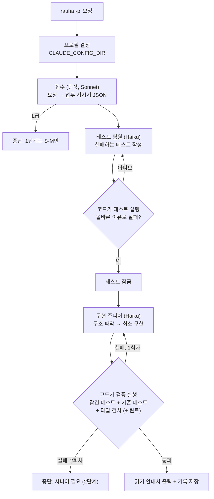

# 1단계 설계: 최소 루프와 프롬프트 실험대

- 날짜: 2026-10-25
- 상위 문서: [`docs/design/claude-team-design.md`](../../design/claude-team-design.md) 「구현 순서」 1단계
- 개발 규칙: [`docs/conventions/ddd-entity-dto.md`](../../conventions/ddd-entity-dto.md)

## 1. 왜 만드는가

이번 단계의 목적은 완성된 기능을 내놓는 것이 아니다. 프롬프트를 바꿔 가며 계속 돌려 보는 **실험대**를 만드는 것이다. 사용자는 아직 정해 둔 작업이 없고, 요청을 반복해서 넣어 보면서 팀원 프롬프트를 다듬을 생각이다.

사용자가 바라는 결과는 세 가지다.

1. **팀원 기본 프롬프트가 정말 잘 짜여 있을 것.** 실행은 빠르고 결과물은 좋아야 한다.
2. **지금 아키텍처에 맞고 충분히 검증된 코드일 것.** 지금까지 AI 코드 생성에서 가장 아쉬웠던 점이 바로 이것이다. 코드가 기존 구조를 무시하고, "새 테스트 통과"만으로 끝났다고 했다.
3. **이 코드를 왜 이렇게 짰는지 짧게 설명할 것.** 사용자는 결과를 받은 뒤 로컬에서 몇 가지를 직접 해 보면서 코드를 조금씩 읽는다. AI가 아무리 좋아져도 본인이 코드를 읽을 줄 알아야 하고, 이 코드를 짠 이유를 남에게 정확히 설명할 수 있어야 하기 때문이다. changelog는 사람들이 잘 안 읽으므로, 설명은 실행이 끝난 직후 사람이 실제로 보는 자리에 있어야 한다.

## 2. 목표 / 하지 않을 것 / 실패로 보는 것

**목표**

- `rauha -p "<요청>"` 한 번으로 S·M급 작업이 다음 흐름을 끝까지 돈다: 접수 → 테스트(Red) → 구현(Green, 주니어) → 검증 → 읽기 안내서.
- 테스트 판정과 검증 통과 여부는 모델의 말이 아니라 코드가 실제 명령을 실행한 결과로 정한다.
- 팀원 프롬프트는 파일로 두고, 고친 뒤 빌드 없이 바로 다시 돌릴 수 있다.
- 실행할 때마다 기록(팀원별 입력·보고·모델·토큰·시간)을 남긴다. 고정 요청 묶음을 한 번에 돌려 프롬프트 버전끼리 숫자로 비교할 수 있다.
- 프로필별 로그인(`CLAUDE_CONFIG_DIR`)으로 실행된다.

**하지 않을 것 (이번 단계)**

- 대화 모드와 Ink UI. `rauha`(인자 없음)는 지금처럼 "구현 전" 안내만 한다.
- 기획(BDD `.feature`), 설계, 리뷰·리팩터, 문서, 디버깅, 인프라 팀.
- 시니어 승격 실제 실행. 주니어가 2회 실패해서 상태 머신이 시니어로 올리는 시점이 오면, 1단계에서는 거기서 멈추고 보고한다. 승격 실행은 2단계에서 붙인다.
- L급 작업. 접수에서 L로 판정되면 시작하지 않고 이유를 알려 준다.
- Node/TypeScript 이외의 대상 프로젝트 지원.

**실패로 보는 것 (돌아가더라도)**

- 기존 구조와 따로 노는 코드. 예: 이미 같은 일을 하는 유틸이 있는데 새로 만들거나, 프로젝트 계층을 무시하는 경우.
- 테스트만 통과하고 타입 검사나 기존 테스트가 깨진 상태를 "완료"라고 보고하는 경우.
- 테스트 값을 하드코딩해서 통과시키는 경우.
- 설명이 길거나 일반론뿐이라, 읽어도 남에게 설명할 수 없는 경우.
- 한 번 돌릴 때마다 오래 걸리고 토큰을 많이 써서 반복 실험이 부담스러운 경우.
- 구독 토큰을 읽거나 옮기는 코드 (CLAUDE.md 금지 사항).

## 3. 전체 흐름



팀장과 팀원은 각자 따로 `query()`를 호출하고, 순서는 rauha 코드(`WorkOrder` 상태 머신)가 정한다. 팀장 모델이 서브에이전트를 직접 부르는 방식은 쓰지 않는다. 이렇게 하는 이유는 세 가지다.

- 상위 설계의 "판정은 코드가 한다" 원칙을 그대로 지킬 수 있다.
- 팀원마다 모델, 도구, 프롬프트, 토큰과 시간을 따로 기록할 수 있다.
- 팀장 컨텍스트가 커지지 않는다.

### 3.1 접수 (팀장)

- 모델은 팀장 등급(sonnet)에 effort `low`를 쓴다. 출력은 `outputFormat`(JSON schema)으로 받는 업무 지시서다.
- 도구는 읽기 전용(Read, Grep, Glob)만 쓴다. 범위를 정하려면 파일을 몇 개 열어 봐야 하기 때문이다.
- 업무 지시서 필드: 제목, 난이도 신호(`fileCount`, `crossModule`, `sensitive`), 범위(경로 패턴), 수용 기준(정상 경로·예외 경로를 Given/When/Then 한 줄씩), 완료 조건, 금지 사항.
  - 난이도 판정은 `Difficulty.judge()`가 한다. 모델은 신호만 낸다.
- 1단계에는 기획 팀이 없다. 그래서 수용 기준의 정상·예외 경로 개수로 `WorkOrder.approveScenario()`를 호출해 `scenario` 단계를 통과시킨다. 수용 기준이 규칙(각 1개 이상)을 못 지키면 같은 호출을 한 번 다시 하고, 그래도 안 되면 중단한다.

### 3.2 테스트 팀원 (Red)

- 쓰기 권한은 기존 `WritePolicy`의 tester 규칙(테스트 파일만)을 따른다.
- 끝나면 rauha 코드가 바뀐 테스트 파일만 골라 실행하고, 결과를 `TestRun`으로 바꿔 `WorkOrder.recordRed()`에 넘긴다.
- 무효한 Red(컴파일·import 실패, 또는 실패가 없음)는 같은 팀원에게 실패 출력 요약을 붙여 다시 맡긴다. 상태 머신 규칙(`INVALID_REDS_BEFORE_SENIOR = 2`)상 두 번째 무효 Red에서 tester 등급이 sonnet으로 오르므로, 실제 재시도는 **1회**이고 그 시점에서 멈추고 보고한다. 상태 머신 상수는 바꾸지 않는다. (내 판단)
- 유효한 Red가 나오면 테스트가 잠긴다(`testsLocked`).

### 3.3 구현 주니어 (Green)

- 입력: 업무 지시서, 잠긴 테스트 파일 경로, (재시도라면) `handoffNote()`.
- 프롬프트가 요구하는 순서:
  1. 기존 구조를 파악한다. 이 기능이 들어갈 자리, 비슷한 일을 하는 기존 코드, 프로젝트 `CLAUDE.md`를 본다.
  2. "기존 X와 같은 방식으로 Y에 넣는다"를 정한다.
  3. 최소한으로 구현한다.
  4. 스스로 검증한다.
  5. 보고한다.
- 끝나면 rauha 코드가 **검증 묶음**을 실제로 실행한다(4절). 전부 통과해야만 `recordGreen()`에 통과 결과를 넘긴다.
- 실패하면 실패 요약을 `failureNote`로 남기고 같은 주니어에게 한 번 더 맡긴다. 상태 머신이 시니어로 올리면 멈춘다.

### 3.4 읽기 안내서 (최종 보고)

실행이 끝나면 터미널에 출력하고, 같은 내용을 실행 기록 폴더에 `guide.md`로 저장한다. 내용은 구현 팀원의 보고와 rauha가 실행한 검증 결과로 조립한다. 이 단계에서는 별도 모델을 호출하지 않는다(속도 때문).

```markdown
[personal] 로그인 실패 제한 · 완료 · 2분 14초 · haiku 2회, sonnet 1회

읽는 순서
  1. src/auth/rate-limit.ts:12   새 규칙의 중심. 여기서 시작
  2. src/auth/login.service.ts:48 로그인 흐름에서 규칙을 부르는 자리
  3. src/auth/rate-limit.spec.ts  무엇을 보장하는지 (잠긴 테스트)

결정과 이유
  - 기존 `Throttle`과 같은 패턴으로 도메인 계층에 둠. 같은 프로젝트에서 같은 문제를 이미 이렇게 풀고 있어서.
  - 실패 횟수는 서비스가 아니라 리포지토리에 저장. 서버가 여러 대일 때도 맞아야 해서. (버린 안: 메모리 Map)

직접 해 볼 것
  - 같은 계정으로 틀린 비밀번호 5번 → 6번째는 "잠김" 응답이어야 함
  - 자동 테스트가 못 잡는 부분: 잠금 해제 시각의 시간대 처리

검증 (rauha가 직접 실행)
  ✓ yarn vitest run src/auth/rate-limit.spec.ts   통과 4
  ✓ yarn test                                     통과 128
  ✓ yarn typecheck
  - 린트: 스크립트 없음, 건너뜀
```

- `파일:줄`은 터미널 하이퍼링크(OSC 8)로 출력해서, VS Code 터미널에서 클릭하면 그 위치로 열리게 한다.
- 결정은 1~4개, 항목마다 1~2줄로 쓴다. "남에게 그대로 말할 수 있는 문장"이 기준이다.
- 대상 코드에 설명 주석을 넣으라고 시키지 않는다. 주석은 그 프로젝트의 습관을 따르고, 설명은 안내서에 둔다.
- 프롬프트에서는 "추론 과정을 써라"라고 요구하지 않고 **"결정 요약"**을 요구한다. Sonnet 5.5 문서에 따르면 추론 과정을 응답에 쓰라는 요구는 `reasoning_extraction` 거절을 부를 수 있다. 결정과 이유를 짧게 요약하라는 요구는 괜찮다.

## 4. 검증 묶음 (코드가 판정)

구현 팀원이 끝나면 rauha가 대상 프로젝트에서 다음을 순서대로 실행한다. 하나라도 실패하면 Green 실패로 친다.

**기준선 (내 판단):** 2~4번은 업무를 시작하기 전에 한 번 돌려 둔다. 검증 때는 "기준선에 없던 새 실패"만 실패로 친다. 원래 깨져 있던 프로젝트에서 매번 멈추지 않게 하기 위해서다. 기존 실패는 안내서에 "원래 깨져 있던 것"으로 따로 표시한다. 비교 단위는 테스트 이름과 타입 에러 `파일:코드`다. 린트처럼 이름을 비교할 수 없는 경우에는 기준선이 통과였을 때만 판정에 쓴다.

| 순서 | 명령 | 없으면 |
| --- | --- | --- |
| 1 | 잠긴 테스트 파일만 실행 | 실패로 처리 (테스트가 있어야 함) |
| 2 | 프로젝트 전체 테스트 (`test` 스크립트) | 건너뜀, 안내서에 표시 |
| 3 | 타입 검사 (`typecheck` 스크립트, 없고 `tsconfig.json`이 있으면 `tsc --noEmit`) | 건너뜀, 표시 |
| 4 | 린트 (`lint` 스크립트) | 건너뜀, 표시 |

- 패키지 매니저는 lockfile로 정한다(yarn / pnpm / npm). 대상 프로젝트의 방식을 따르고, rauha 저장소의 "yarn만" 규칙을 대상에 강요하지 않는다.
- 테스트 결과(통과 수, 실패 수, 실패 이름, 실패 종류)를 얻는 방법:
  - **1단계는 vitest만 정식으로 지원한다**(JSON reporter 사용). 실패 종류(assertion / compile / import / timeout)는 이 출력에서 분류한다.
  - vitest가 아니면 종료 코드만으로 판정하고, 안내서에 "결과 세부 정보 없음"이라고 표시한다.
- 바뀐 파일은 팀원 호출 전후의 `git status`로 구한다. 그래서 대상은 git 저장소여야 하며, 아니면 시작을 거부한다. 이 목록을 `WorkOrder.assertDiffAllowed()`로 검사하고, 거부되면 그 시도는 실패로 친다.
- 쓰기 권한은 두 겹으로 막는다.
  - 실행 중에는 `PreToolUse` 훅이 `Edit`/`Write` 경로를 `WritePolicy`로 검사해 바로 거절한다. 팀원이 헛수고를 안 하게 하기 위해서다.
  - 실행 뒤에는 위의 git 기준 검사로 최종 판정한다. Bash로 우회해서 쓴 경우를 잡기 위해서다. 비교 기준은 시작 시점의 커밋(`HEAD`)과 작업 트리 상태다. 그래서 팀원이 커밋을 해도 변경을 놓치지 않는다.
- **도구 권한 (사용자 결정, 2026-10-25):** 기본은 자동으로 허용하고, 정말 위험한 동작만 사용자에게 허락을 받는다.
  - **자동 허용:**
    - Bash 전반: 테스트, 빌드, 타입 검사, 설치, 조회용 명령 등
    - 웹 검색과 웹 페이지 읽기(`WebSearch`, `WebFetch`)
    - 역할 권한(`WritePolicy`) 안에서의 Edit/Write
  - **허락 받기 (위험 동작).** `PreToolUse` 훅이 `permissionDecision: "ask"`를 돌려주면, `canUseTool` 콜백이 터미널에 명령을 보여 주고 y/n을 묻는다.
    - git 쓰기: `reset`, `checkout`/`restore`, `clean`, `stash`, `rebase`, `merge`, `branch -D`, `tag` 등
    - 파일·폴더 지우기: `rm`, `rmdir`, `del`, `Remove-Item` 등. Windows 명령도 포함한다.
    - 대상 폴더 밖 경로에 쓰기
    - 전역 설치, 배포(`publish`), `sudo`
  - **항상 거절:** `git commit`, `git push`. rauha는 커밋하지 않는다는 결정(12절) 때문이다.
  - **묻는 화면이 없을 때:** stdin이 터미널이 아니거나 bench로 실행 중이면 위험 동작은 묻지 않고 거절한다.
  - 거절된 호출은 실행 기록의 `permission_denials`에 남는다.
  - `WritePolicy`의 역할 권한은 위험 동작 목록과 별개로 계속 강제한다. 예: 구현 팀원은 잠긴 테스트를 고칠 수 없다. 이건 위험 여부가 아니라 판정의 공정성 문제이므로, 묻지 않고 거절한다.
  - 위험 동작 판정 패턴은 domain의 값 객체로 두고, 한국어 규칙 문장 spec으로 고정한다. (내 판단)

### 4.1 종료 상태 (내 판단)

1단계에는 리뷰 팀이 없다. 그래서 `recordGreen`이 단계를 `review`로 넘긴 것을 **1단계 완료**로 본다.

- 엔티티에 1단계 전용 전이는 추가하지 않는다.
- `work-order.json`에는 `stage: review`를 그대로 저장한다.
- 안내서와 bench 표에는 "완료(리뷰 전)"으로 표시한다.
- bench의 "시도" 열은 구현 팀원 호출 횟수로 센다.

## 5. 팀원 기본 프롬프트

### 5.1 파일과 구조

- 역할마다 파일 하나를 둔다: `intake.md`, `tester.md`, `implementer.md`. 공통 앞부분(`_common.md`)과 합쳐서 쓴다.
- 런타임에 파일에서 읽는다. 기본 위치는 저장소의 `prompts/`이고, 환경 변수 `RAUHA_PROMPTS_DIR`로 다른 폴더를 가리킬 수 있다. 프롬프트 변형 A/B를 폴더째 바꿔 가며 비교하기 위해서다.
- 실행 기록에 프롬프트 파일들의 해시를 남겨서, 어떤 버전으로 돌린 결과인지 알 수 있게 한다.

### 5.2 공통 원칙 (조사 근거와 함께)

출처: Anthropic [Prompting best practices](https://platform.claude.com/docs/en/build-with-claude/prompt-engineering/claude-prompting-best-practices), [Prompting Claude Haiku 5.5](https://platform.claude.com/docs/en/build-with-claude/prompt-engineering/prompting-claude-haiku-5-5), [Prompting Claude Sonnet 5.5](https://platform.claude.com/docs/en/build-with-claude/prompt-engineering/prompting-claude-sonnet-5-5).

- **이유를 함께 적는다.** "무엇을 하지 마라"만 쓰지 않고 왜 그런지를 붙인다. 문서에 따르면 이유를 주면 더 목표에 맞게 행동한다.
- **XML 태그로 칸을 나눈다:** `<role>`, `<work_order>`, `<steps>`, `<rules>`, `<report_format>`. 바뀌는 입력(업무 지시서 등)은 사용자 메시지에 넣고, 시스템 프롬프트는 고정한다. 그래야 프롬프트 캐시가 먹는다.
- **먼저 읽고 쓴다.** 파일을 열어 보지 않고 추측해서 쓰지 말라고 한다. 여러 파일은 병렬로 읽게 한다(문서: 병렬 도구 호출은 속도를 올린다).
- **끝까지 하고, 시킨 것만 한다.** Haiku 5.5 문서의 조기 종료 방지 문단을 그대로 쓴다: "요청한 일이 끝나고 확인됐으면 멈추고 보고한다. 요청하지 않은 기능·문서·리팩터는 하지 말고, 도움이 될 것 같으면 끝에 언급만 한다."
- **실제로 검증한다.** Haiku 5.5와 Sonnet 5.5 문서의 검증 문단을 그대로 쓴다: 문법 검사나 시작도 못 한 명령은 검증으로 치지 않는다.
- **테스트에 맞춰 하드코딩하지 않는다.** 테스트는 정답 확인용이지 정답 그 자체가 아니다.
- **보고는 정해진 JSON으로.** `outputFormat`을 쓴다. 단, Haiku 5.5에서 thinking을 끄고 JSON 출력을 쓰면 필요한 도구 호출을 건너뛸 수 있으므로, adaptive thinking(기본값)을 유지한다.
- **스타일 중립.** rauha 자체의 DDD 규칙은 넣지 않는다(CLAUDE.md 주의 사항). 대상 프로젝트의 `CLAUDE.md`, 린트 설정, 기존 코드를 따르라고만 한다.

### 5.3 역할별 핵심

| 역할 | 꼭 들어갈 내용 |
| --- | --- |
| 접수 (팀장) | 범위는 좁게 잡는다(파일 몇 개). 난이도 신호는 추측하지 말고 열어 본 근거로 낸다. 수용 기준은 테스트로 옮길 수 있는 구체적인 문장으로 쓴다. 코드는 쓰지 않는다. |
| 테스트 | 기존 테스트 파일의 위치·이름·스타일을 따른다. 정상 경로, 경계값, 실패 경로를 쓴다. 구현이 없어서 실패하되 컴파일·import 에러로 실패하면 안 된다(필요하면 최소한의 export 시그니처가 있는지 확인한다. 단, 구현 파일 쓰기는 금지이므로 import 경로를 기존 구조에 맞게 고른다). |
| 구현 | 3.3절의 순서를 따른다. 잠긴 테스트는 고칠 수 없다. 범위 밖 파일은 쓰지 않는다. 기존 유틸·패턴을 재사용한다. 보고에 결정 요약, 읽는 순서(파일:줄), 직접 해 볼 것을 넣는다. |

테스트 팀원 칸의 "컴파일 실패 없이 Red 만들기"는 구현 파일이 아직 없을 때 까다롭다. 처리 방식은 7절의 빌더 판단에 둔다.

### 5.4 보고 양식 확장

기존 `WorkReportDto`(결과, 한 일, 바뀐 파일, 테스트, 남은 문제, 판단 필요)는 팀장용 짧은 보고이고 300토큰 예산을 지킨다. 구현 팀원은 여기에 **설명 칸**을 따로 붙인다. 설명 칸은 별도 예산을 가진다(빌더 판단, 대략 400토큰).

- `decisions`: 1–4개, 각 `{ what, why, rejected? }`
- `readingOrder`: 2–4개, 각 `{ path, line, note }`
- `manualChecks`: 1–3개, 각 한 줄
- `untested`: 자동 테스트가 못 잡는 부분. 없으면 비움

팀장 컨텍스트에는 짧은 보고만 들어가고, 설명 칸은 안내서 조립에만 쓴다.

## 6. 빠르게 도는 장치

| 장치 | 내용 |
| --- | --- |
| 짧은 시스템 프롬프트 | `claude_code` preset 대신 rauha 자체 프롬프트(문자열)를 쓴다. 앞부분이 짧고 고정이라 빠르고 캐시가 잘 먹는다. |
| 역할에 맞는 도구 | 접수: Read/Grep/Glob/WebSearch/WebFetch. 테스트·구현: 여기에 Edit/Write/Bash를 더한다. 위험 동작만 묻는다(4절). |
| 턴·비용 상한 | 역할별 `maxTurns`와 `maxBudgetUsd`(안전장치). 값은 실험대로 조정한다. |
| effort | 역할별로 설정 가능하게 둔다. 기본값: 접수 `low`, 테스트·구현 `medium`. Haiku 5.5 문서상 `low`는 빠르지만 조기 종료와 검증 생략이 늘어난다. 실험대 결과로 정한다. |
| 맥락 최소화 | 팀원에게는 지시서, 경로, 줄 번호만 넘긴다. 파일 내용은 팀원이 직접 읽는다. |
| 대상 테스트만 | Red 판정과 1차 Green 판정은 해당 파일만 실행한다. 전체 테스트는 검증 묶음에서 한 번만 돌린다. |

## 7. 실험대

### 7.1 연습용 프로젝트

- `examples/sandbox/`: 작은 TypeScript + vitest 프로젝트. 계층이 있는 구조(예: 도메인/서비스 두 층, 이미 쓰고 있는 유틸 몇 개)로 만든다. "기존 구조를 따르는가"를 실제로 시험할 수 있어야 하기 때문이다. `CLAUDE.md`도 하나 둔다.
- 실행할 때마다 임시 폴더에 새로 복사하고 `git init`과 첫 커밋을 한 뒤 그 안에서 돌린다. 매번 같은 출발점에서 시작하고, 원본은 더럽히지 않기 위해서다.

### 7.2 고정 요청 묶음과 비교

- `examples/bench/requests.json`: 요청 5~8개. S급과 M급을 섞고, 기존 유틸을 재사용해야 정답인 요청을 최소 2개 넣는다.
- `yarn bench`(또는 `rauha bench`, 빌더 판단): 요청마다 새 복사본에서 실행하고, 끝나면 표를 출력하고 저장한다.

```
프롬프트 a1b2c3 · 2026-10-25 14:02
요청                       결과   시도  시간    haiku 토큰  sonnet 토큰  추정 비용
문자열 뒤집기 추가          완료   1     0:48    21k         3k           $0.01
금액 포맷 유틸 재사용       완료   2     1:55    64k         3k           $0.02
...
첫 시도 성공 5/7 · 평균 1:21 · 합계 $0.09
```

- 실행 기록과 같은 형식이므로, 두 번 돌린 결과 폴더를 나란히 비교할 수 있다. 비교 화면은 1단계에서 만들지 않는다.

### 7.3 실행 기록

- 위치: 프로필 폴더 아래 `~/.rauha/profiles/<이름>/runs/<runId>/`. work 프로필 기록이 PC 밖으로 나가지 않는다는 상위 설계와 맞추기 위해서다.
- 내용:
  - `work-order.json`: 업무 지시서와 최종 상태
  - 팀원 호출마다 한 파일: 역할, 모델, effort, 보낸 사용자 메시지, 받은 보고, `modelUsage`, `total_cost_usd`, `duration_ms`, `num_turns`, 종료 사유, 거절된 도구 호출
  - rauha가 실행한 검증 명령의 출력(잘라서)
  - `guide.md`
  - 프롬프트 해시
- 토큰과 비용은 SDK 결과 메시지의 `modelUsage`(서브 호출 포함)를 쓴다. `total_cost_usd`는 로컬 추정치이므로 "추정 비용"으로 표시한다. 상위 설계의 체크리스트 항목 "작업별 모델·토큰 사용량 기록 방식 결정"을 이걸로 닫는다.

## 8. 프로필과 로그인

- `~/.rauha/config.toml`을 읽는다. 파일이 없으면 지금의 기본값을 쓴다. 파싱은 TOML 라이브러리로 하고 `ProfileConfigDto.from()`에 넘긴다.
- `rauha login [--profile <이름>]`: 해당 프로필의 설정 폴더를 `CLAUDE_CONFIG_DIR`로 지정한 채 Claude Code 로그인 절차를 띄운다. 사용자는 브라우저로 인증한다. rauha는 토큰 파일을 읽지도 옮기지도 않는다.
- 모든 `query()` 호출에 `env: { ...process.env, ...profile.agentEnv(home) }`를 넘긴다. SDK의 `env`는 환경 전체를 바꾸므로 `process.env`를 펼쳐야 PATH가 유지된다.
- 출력 첫 줄에는 항상 프로필 배지(`[personal]` / `[work]`)를 붙인다.
- 1단계 범위 밖: 회사 폴더에서 personal로 실행하면 막는 안전장치(상위 설계의 안전장치 1). 이건 지금 `ProfileBook`에 이미 있으면 그대로 쓰고, 없으면 2단계로 미룬다.

## 9. 코드 배치 (rauha 개발 규칙에 맞춰)

- **domain** (Node·SDK import 없음): 기존 `WorkOrder`, `TestRun`, `WritePolicy`, `Difficulty`를 그대로 쓴다. 필요하면 `VerificationResult`(검증 묶음 결과 값 객체: 단계별 통과·실패·건너뜀, 전체 통과 여부 판정)를 추가한다.
- **application**:
  - DTO: `IntakeDto`(접수 JSON → 업무 지시서, `toEntity`), 확장된 구현 보고 DTO(설명 칸 검증), `VitestReportDto`(vitest JSON → `TestRun`), `ReadingGuideDto`(`toMarkdown`, 터미널용 출력).
  - 파이프라인 서비스: `nextAssignment()`를 보고 해당 팀원을 부르고, 결과를 엔티티 메서드에 넘기는 일만 한다. 언제 멈출지 같은 판단은 엔티티에 둔다.
    - 1단계 전용 판단 "시니어가 필요해지면 멈춤"은 서비스의 `if`가 아니라 "이번 실행에서 지원하는 배정인지"를 답하는 값 객체나 정책 객체로 표현한다.
- **infrastructure**:
  - Agent SDK 호출 어댑터(역할 설정 → `query()` 옵션)
  - 프롬프트 파일 로더
  - 명령 실행기(테스트·타입 검사·린트, git status)
  - 실행 기록 저장소(파일)
  - config.toml 로더
- **cli**: `-p`, `login`, `bench` 연결, 하이퍼링크 출력.
- 규칙이 바뀌는 곳은 실패하는 `*.spec.ts`부터 쓴다(한국어 규칙 문장). SDK를 실제로 부르는 테스트는 기본 `yarn test`에 넣지 않는다. 어댑터는 가짜 구현으로 서비스 흐름을 테스트한다.

## 10. 사용자가 정한 것 / 내가 정한 것

**사용자가 정한 것**

- 1단계는 실험대 성격이다. 프롬프트를 계속 넣어 보며 다듬는다.
- 팀원 기본 프롬프트의 품질, 빠른 실행, 좋은 결과물을 우선한다.
- 좋은 결과의 기준은 기존 아키텍처를 따를 것, 충분히 검증할 것, 짠 이유를 짧게 설명할 것이다.
- 설명은 로컬 테스트를 하며 코드를 읽을 때 쓴다. 목적은 이해하고 남에게 설명하는 것이다.
- 모델은 5.5 계열(현행)을 쓴다.
- rauha는 커밋하지 않는다. 커밋은 언제나 사용자가 직접 한다.
- Bash와 웹 검색은 자동으로 허용한다. git 쓰기, 파일 지우기 같은 정말 위험한 동작만 사용자에게 허락을 받는다.

**내가 정한 것 (검토해 주세요)**

- 팀원을 따로 호출하고 코드가 순서를 정하는 구조. 팀장 모델이 서브에이전트를 부르는 방식은 쓰지 않는다.
- 1단계 팀장 모델의 일은 접수 하나로 줄이고, 안내서는 모델 호출 없이 코드로 조립한다.
- 기획 팀이 없는 동안 수용 기준으로 `scenario` 단계를 통과시킨다.
- vitest만 정식 지원하고, 나머지 러너는 종료 코드로만 판정한다.
- 대상은 git 저장소여야 한다.
- 검증 묶음: 대상 테스트 → 전체 테스트 → 타입 검사 → 린트.
- 연습용 프로젝트는 매번 임시 복사본에서 돌린다.
- 실행 기록은 프로필 폴더 아래에 둔다.
- `claude_code` preset 대신 자체 시스템 프롬프트를 쓴다.
- effort 기본값은 접수 low, 나머지 medium.
- 검증은 기준선 대비 새 실패만 실패로 친다.
- `git commit`·`push`는 묻지 않고 항상 거절한다(커밋은 사용자 몫).
- 묻는 화면이 없을 때(bench, 파이프)는 위험 동작을 거절한다.
- 무효 Red 재시도는 1회. 상태 머신 상수는 그대로 둔다.
- `review` 도달을 1단계 완료로 본다.

## 11. 빌더에게 맡기는 것

- 프롬프트 문장 자체. 5절의 원칙과 역할별 핵심은 지켜야 한다.
- `maxTurns`와 `maxBudgetUsd` 초기값, 설명 칸 토큰 예산.
- 테스트 팀원이 구현 파일이 없는 상태에서 import 에러 없이 Red를 만드는 방법. 예: 테스트 팀원에게 빈 export 시그니처 생성을 허용하는 예외 규칙, 또는 컴파일 실패를 "구현 없음"으로 인정하는 판정 조정. 상태 머신 규칙을 바꾸게 되면 spec부터 쓴다.
- TOML 라이브러리 선택, 실행 기록 파일 이름과 형식, `bench`를 CLI 하위 명령으로 둘지 스크립트로 둘지.
- `settingSources`를 어떻게 줘야 자체 시스템 프롬프트를 쓰면서도 대상 프로젝트 `CLAUDE.md`가 로드되는지. 실제로 확인한 뒤 정하고, 안 되면 프롬프트에서 "먼저 `CLAUDE.md`를 읽어라"로 대신한다.

## 12. 사용자 결정 (2026-10-25)

- **모델은 현행 5.5 계열을 쓴다.** 사용자 요청: "opus 5.5로 가고 좋은 모델로."
  - 모델 ID와 요금. 출처: 공식 [Models overview](https://platform.claude.com/docs/en/about-claude/models/overview), 2026-10-25 확인.

    | 등급 | 모델 ID | 입력 / 출력 (100만 토큰당) | 특징 |
    | --- | --- | --- | --- |
    | haiku | `claude-haiku-5-5` | $0.10부터 / $0.50부터 | 가장 빠름, 1M 컨텍스트 |
    | sonnet | `claude-sonnet-5-5` | $2 / $10 | |
    | opus | `claude-opus-5-5` | $4 / $20 | |

  - 작업 사본에서 4.5 / 5 / 5로 바꿨던 `team.ts`, `work-order.service.spec.ts`, 상위 설계 문서의 모델 표기는 5.5 계열로 되돌린다.
  - Pro 로그인으로 세 ID가 호출되는지는 구현 첫 작업에서 `claude -p --model <id>`로 확인한다.
  - 역할별 등급(주니어 = haiku, 팀장·시니어 = sonnet, 설계 = opus)은 상위 설계대로 둔다. 승격 사다리의 절약 구조를 지키기 위해서다. (내 해석) 역할별 effort와 모델은 설정으로 바꿀 수 있고, 실험대 결과가 나쁘면 등급을 올린다.
- **rauha는 커밋하지 않는다. 커밋은 언제나 사용자가 직접 한다.**
  - 성공하든 실패하든 변경은 작업 트리에 그대로 둔다. 실패했을 때는 안내서에 되돌리는 방법(`git checkout -- <파일>` / `git clean`)을 적는다.
  - 팀원의 `git commit`은 4절 Bash 규칙에서 막는다.
  - 커밋하지 않은 변경이 있는 상태에서는 시작을 막는다. rauha가 바꾼 것과 사용자가 바꾼 것이 섞이지 않게 하기 위해서다. 메시지로 커밋이나 stash를 안내한다. (내 판단)
  - 연습용 실행(bench, 임시 복사본)은 예외다. 출발점을 만들 때만 rauha가 첫 커밋을 한다.
