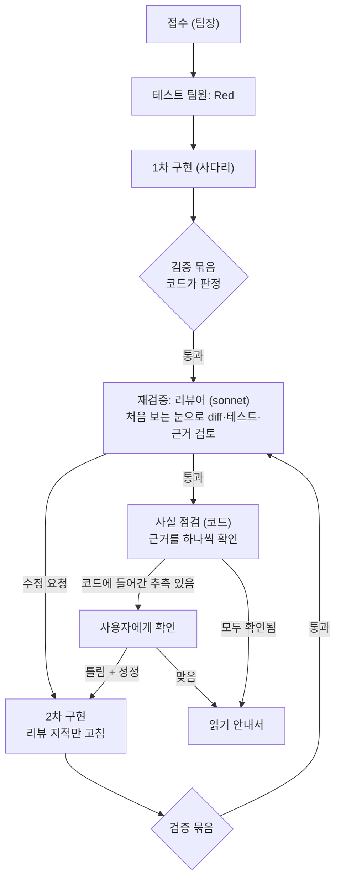

# 2단계 설계: 승격 사다리, 사실 기반 3단 작업, 대화 모드

- 날짜: 2026-10-25
- 상위 문서: [`docs/design/claude-team-design.md`](../../design/claude-team-design.md) 「구현 순서」 2단계 + 대화 모드
- 앞 단계: [`2026-10-25-step1-minimal-loop-design.md`](2026-10-25-step1-minimal-loop-design.md)
- 개발 규칙: [`docs/conventions/ddd-entity-dto.md`](../../conventions/ddd-entity-dto.md)

## 1. 왜 만드는가

사용자의 최종 목표는 **추가 Claude 비용 없이, 구독 안에서 나만의 하네스로 AI를 최대한 많이, 잘 시키는 것**이다. 같은 구독으로 힘을 키우는 방법은 클라우드 자원이 아니라 설계다. 싼 모델로 먼저 시도하고, 모델에 넘기는 맥락을 줄이고, 판정은 코드가 한다.

이번 단계는 세 덩어리다.

1. **승격 사다리.** 지금은 haiku 구현 팀원이 두 번 실패하면 멈춘다. sonnet 시니어가 실패 요약을 받아 이어받게 하고, 이 방식이 처음부터 sonnet을 쓰는 것보다 정말 싼지 숫자로 확인한다.
2. **사실 기반 3단 작업.** 사용자가 가장 크게 데인 경험은 "웹에서 찾아보겠다"던 AI가 나중에 물어보니 자기 가설이었다고 말한 일이다. 틀린 것보다 **추측을 조사한 사실처럼 말한 것**이 문제였다. 그래서 모든 결정과 외부 사실에 출처를 붙이게 하고, 그 출처가 진짜인지는 모델이 아니라 코드가 확인한다. 작업은 기본값으로 1차 구현 → 재검증과 2차 구현 → 사실 점검의 3단으로 한다.
3. **대화 모드.** `rauha`만 치면 Claude Code처럼 입력창에서 요청을 이어서 주고받는다. `/clear`로 지금 대화를 비워 빨라지되, 지난 작업은 그래프 기억으로 남아서 "아까 그 기능"을 다시 찾을 수 있다.

만드는 순서는 1 → 2 → 3이다. 앞의 둘은 "요청 하나를 얼마나 잘 처리하나"이고, 대화 모드는 그걸 여러 번 이어 붙인다.

## 2. 목표 / 하지 않을 것 / 실패로 보는 것

**목표**

- haiku 구현 주니어가 2회 실패하면 sonnet 구현 시니어가 5줄 실패 요약을 받아 이어서 한다. 시니어도 실패하면 멈추고 보고한다.
- bench가 "haiku부터 시작해 필요할 때 올리기"와 "처음부터 sonnet"을 같은 요청 묶음에서 나란히 비교한다(성공률·시간·토큰·추정 비용).
- 모든 요청은 기본값으로 3단을 거친다: 1차 구현, 리뷰어의 재검증과 그에 따른 2차 구현, 사실 점검.
- 구현 보고와 리뷰 보고의 결정·외부 사실마다 근거가 붙고, rauha 코드가 근거를 확인한다. 확인되지 않은 주장은 안내서에 "추측"으로 표시되고, 코드에 들어간 추측은 끝내기 전에 사용자에게 확인받는다.
- `rauha`(인자 없음)로 대화 모드가 열린다. 작업 요청과 질문을 구분해서, 질문에는 테스트·구현 없이 바로 답한다. 답에도 같은 근거 규칙을 적용한다.
- "왜 이렇게 짰어?"에는 그 작업 때 실제로 기록된 결정으로 답한다. 기록이 없으면 코드를 읽고 추측이라고 밝힌다.
- `/clear` 뒤에도 지난 작업을 그래프 기억에서 찾고, 흐릿한 지시("아까 그 기능")는 후보를 보여 주고 확인받은 뒤 진행한다.
- 대화 모드 화면은 창 크기를 바꿔도 깨지지 않는다(다시 그리는 TUI).

**하지 않을 것 (이번 단계)**

- 디버깅 팀, opus 설계 자문, 기획(BDD) 팀, 문서 팀. 설계상 3·4단계다. 시니어가 실패하면 상태 머신은 디버깅 지원을 요청하는데, 이번 단계는 그 지점에서 멈추고 보고한다.
- L급 작업. 지금처럼 접수에서 L로 판정되면 시작하지 않는다.
- AWS(S3, SageMaker, Neptune 등)와 여러 PC 간 기억 동기화. 기억 저장은 바꿔 끼울 수 있게 포트 하나로 모아 두기만 한다.
- 임베딩이나 학습을 쓰는 "의미로 찾기". 기억 찾기는 단어 검색과 그래프 이웃으로 한다.
- 대화 모드 명령 중 `/profile`, `/team`, `/open`.
- Node/TypeScript 이외의 대상 프로젝트.

**실패로 보는 것 (돌아가더라도)**

- 근거가 없거나 확인에 실패한 주장을 안내서나 답변에서 사실처럼 말하는 것. 이번 단계에서 가장 중요한 실패다.
- 모델이 "확인했다"고 말한 것을 rauha가 그대로 믿는 것. 근거 확인은 코드가 한다.
- 승격 때 이전 시도의 대화 전체를 시니어에게 넘기는 것. 요약 5줄만 넘긴다.
- 3단 작업 때문에 S급 요청 한 번이 지나치게 느려지거나 비싸지는 것. bench로 재서 보고한다(기준은 6장).
- `/clear` 뒤에 사용자 확인 없이 엉뚱한 지난 작업을 "아까 그 기능"으로 잡고 고치는 것.
- 다른 프로젝트의 기억이 섞여 나오는 것.
- 구독 토큰을 읽거나 옮기는 코드 (CLAUDE.md 금지 사항).

## 3. 승격 사다리

### 3.1 지금 있는 것

`WorkOrder`에는 사다리 규칙이 이미 있다(`climbAfterFailure`): junior 2회 실패 → senior, senior 실패 → 디버깅 지원 요청(`pendingSupport = 'debugger'`). `nextAssignment()`는 senior 단계에서 implementer + sonnet을 돌려준다. `handoffNote()`는 실패 요약 최근 5줄을 돌려준다.

막혀 있는 곳은 `RunScope.minimalLoop()`다. 배정 모델이 haiku가 아니면 `needs-senior`로 멈춘다.

### 3.2 바꾸는 것

- **범위:** `RunScope`에 2단계 범위를 추가한다. green 단계에서 implementer는 haiku와 sonnet 모두 허용한다. `pendingSupport`가 생기면(시니어 실패) 지금처럼 `needs-support`로 멈춘다. 테스트 팀원도 상태 머신이 sonnet으로 올리는 경우(무효 Red 2회)를 허용한다. review 단계는 4장의 리뷰어가 맡는다.
- **역할 설정:** 지금 `RoleSettingsDto`는 역할마다 모델이 하나로 고정돼 있다. 모델은 `WorkOrder.nextAssignment()`가 정하고, 역할 설정은 모델별 effort·턴·예산 상한을 준다. 예: implementer haiku는 medium/40턴/$1, implementer sonnet은 medium/40턴/$2(값은 빌더가 정함). `RAUHA_ROLE_<ROLE>=tier[:effort]` 덮어쓰기는 "이 역할은 이 모델로 고정"이라는 뜻으로 남겨서 bench 비교에 쓴다.
- **시니어에게 넘기는 것:** `<handoff>`(WorkOrder의 실패 요약 5줄)와 `<last_failure>`(rauha가 직접 본 마지막 실패 메시지)만 넘긴다. 이전 시도의 대화는 넘기지 않는다. 시니어 프롬프트는 구현 프롬프트를 같이 쓰고, 승격된 시도라는 사실과 "앞 시도와 다른 접근을 하라"는 지시만 메시지에 더한다.
- **기록:** 실행 기록과 bench 표에 "승격 여부"와 "어느 단계에서 끝났는지(junior n회 / senior)"를 남긴다.

### 3.3 비용 비교 (bench)

- `rauha bench --compare`: 요청마다 두 번 돌린다. A = 기본(haiku부터 사다리), B = 구현 팀원을 sonnet으로 고정(`RAUHA_ROLE_IMPLEMENTER=sonnet`). 표에 A/B의 성공률, 평균 시간, 모델별 토큰, 추정 비용, 승격된 횟수를 나란히 보여 준다.
- 사다리가 실제로 오르는지 보려면 haiku가 실패할 만한 요청이 있어야 한다. 연습용 프로젝트 요청 묶음에 M급 요청 2개 이상(파일 3–5개, 기존 구조를 여러 곳 맞춰야 하는 것)을 추가한다.
- 결과 해석(사다리가 싼가)은 설계 문서 「모델」 절의 확인 안 된 항목에 숫자로 채운다.

## 4. 사실 기반 3단 작업

### 4.1 흐름

- 3단은 **기본값**이다. 실험과 비교를 위해 끄는 옵션(`--quick` 또는 환경 변수, 이름은 빌더 판단)을 둔다. 끄면 1단계처럼 검증 통과 시 완료한다.
- 리뷰 수정 요청이 2번 나오면 지금 상태 머신 규칙대로 멈춘다(`review-loop`).
- 리뷰어가 통과를 줘도 2차 구현이 "없을" 수 있다. 3단의 의미는 "두 번째 눈의 확인"이지 "반드시 두 번 고친다"가 아니다.

### 4.2 근거(evidence)

구현 보고의 `explanation.decisions`와 새 필드 `facts`(코드에 들어간 외부 사실: API 경로, 요청·응답 필드, 설정 키, 라이브러리 동작 등)는 항목마다 근거 목록을 가진다. 근거는 네 종류다.

| 종류 | 팀원이 쓰는 것 | rauha가 확인하는 방법 |
|---|---|---|
| code | 경로, 줄, 인용한 코드 조각 | 그 파일의 그 줄 근처(앞뒤 몇 줄)에 인용 조각이 실제로 있는지. 공백 차이는 무시 |
| test | 테스트 이름 | 이번 실행의 검증 묶음에서 그 테스트가 실제로 돌았고 통과했는지 |
| web | URL, 인용한 문장 | 이번 팀원 호출에서 그 URL을 WebFetch로 실제로 열었는지(도구 기록). 인용 문장이 가져온 본문에 있는지는 본문을 남길 수 있으면 확인, 아니면 "열었음"까지만 |
| user | 사용자가 정한 해석·답 | 접수의 확정된 가정이나 대화 기록에 그 내용이 있는지 |

- 근거가 하나도 없거나 하나도 확인되지 않은 항목은 **추측**이다.
- 리뷰어도 같은 근거 규칙으로 보고한다. 리뷰어의 지적("이 필드 이름은 백엔드와 다르다")도 근거가 있어야 수정 요청으로 인정한다. 근거 없는 지적은 안내서에 "리뷰어 추측"으로만 남기고 2차 구현을 일으키지 않는다.
- 근거 확인은 도메인 규칙이다(예: `Evidence`, `FactCheck` 값 객체와 판정 메서드). 파일 읽기와 도구 기록 모으기는 인프라가 한다.

### 4.3 추측 처리

- 안내서에는 "확인된 근거"와 "추측"을 섞지 않는다. 추측은 따로 모아 "⚠ 추측(근거 확인 안 됨)" 절에 둔다.
- 추측이 **코드에 들어간 사실**(facts 항목)이면, 화면이 있을 때는 끝내기 전에 사용자에게 묻는다: 맞음 / 틀림(정정 내용 입력). 틀림이면 정정 내용을 근거(user)로 붙여 2차 구현으로 돌린다. 화면이 없으면(bench, 파이프) 묻지 않고 안내서에 "확인 필요"로 남긴다.
- 결정(decisions)의 이유가 추측이면 묻지 않고 안내서에 표시만 한다.

### 4.4 프롬프트

- 공통: "확인하지 않은 것은 추측이라고 쓴다. 찾아보겠다고 했으면 실제로 열어 본다. 근거 없는 사실을 코드에 넣어야 하면 facts에 추측으로 적고 진행한다."
- 리뷰어 프롬프트(새 파일): 처음 보는 눈으로 diff, 잠긴 테스트, 구현 보고의 근거를 읽는다. 수용 기준·기존 구조·근거와 어긋나는 것만 지적하고, 취향 문제는 지적하지 않는다.

## 5. 대화 모드

### 5.1 화면 (Ink)

- `rauha`(인자 없음)로 시작한다. 맨 위는 지금 `-p`의 시작 박스(Delfi + rauha + 인사말 + 작업 폴더), 아래는 Claude Code처럼 테두리 있는 입력창.
- 화면은 Ink(React 기반 터미널 UI)로 그려서 창 크기가 바뀌면 다시 그린다. 1단계에서 확인한 cmd 한글 글꼴 제약을 그대로 지킨다: 줄 마지막 칸에 배경색 금지, 박스 테두리는 1/8 블록(▁▔▕▏), 박스 안에 폭이 애매한 글자(·, ◆ 등) 금지, 스피너는 사분면 블록.
- 진행 표시, 위험 동작 허락(박스 + 선택 목록), 해석 고르기, 추측 확인, 기억 후보 확인을 모두 같은 박스·선택 목록 모양으로 그린다.
- `-p`는 지금 출력 방식을 유지해도 되고, Ink 부품을 써도 된다(빌더 판단). 화면이 없을 때(파이프, bench)는 지금처럼 글자만.
- Delfi와 하늘색 계열을 유지한다.

### 5.2 한 번의 입력이 처리되는 방식

1. 팀장(접수)이 입력을 받는다. 접수 메시지에는 지금 세션 대화의 짧은 요약과, 기억에서 찾은 관련 항목(5.4)이 함께 들어간다.
2. 접수는 먼저 입력의 종류를 정한다: **작업**(코드를 바꿈) / **질문**(코드를 바꾸지 않음).
3. 작업이면 지금까지의 흐름(4장)을 그대로 돈다. 입력이 지난 작업을 가리키면 5.5를 먼저 한다.
4. 질문이면 팀장이 읽기 도구로 답을 만들고, 답의 주장마다 근거를 붙인다(4.2와 같은 규칙). rauha가 근거를 확인한 뒤, 확인된 부분과 추측을 구분해서 보여 준다.
   - "왜 이렇게 짰어?" 류의 질문은 기억에 기록된 그 작업의 결정·이유·버린 대안을 먼저 쓴다. 기록이 없는 코드면 코드를 읽고 답하되 "기록된 이유가 아니라 코드를 보고 추측한 것"이라고 밝힌다.

### 5.3 세션과 `/clear`

- 세션 대화: 입력과 결과 요약(업무 제목, 결과, 바뀐 파일)의 목록. 팀장에게는 최근 몇 개만 짧게 넘긴다.
- `/clear`: 세션 대화를 비운다. 기억(그래프)은 그대로 둔다.
- 기본 명령: `/clear`, `/status`(지금 단계·승격 상황), `/usage`(이번 세션 모델별 토큰·추정 비용), `/help`, `/exit`.
- **커밋 안 한 변경:** 대화 모드는 세션 시작 때 이미 있던 변경이 있으면 지금처럼 시작 전에 알린다. 세션 중에 rauha가 만든 변경 위에서는 다음 요청을 계속 받는다(그 변경 파일 목록을 세션이 기억). 사용자가 직접 고친 파일이 섞이면 시작 전에 알린다.

### 5.4 그래프 기억

- **저장:** 로컬 SQLite 파일 하나. 위치는 프로필 폴더 아래, **프로젝트(git 저장소)마다 따로**(사용자 승인). AWS나 서버는 쓰지 않는다.
- **점(node):** 작업(업무 제목), 요청, 파일, 테스트, 결정(내용·이유·버린 대안·근거), 정한 해석, 질문과 답.
- **선(edge):** 작업 → 바꾼 파일, 작업 → 잠근 테스트, 작업 → 결정, 작업 → 정한 해석, 요청 → 작업, 보충 작업 → 원래 작업, 답 → 근거 파일.
- **만드는 쪽은 코드:** 실행이 끝나면 실제로 일어난 일(바뀐 파일, 통과한 테스트, 확인된 근거, 확정된 가정)로 점과 선을 만든다. 모델이 짐작한 연결은 넣지 않는다. "보충 작업 → 원래 작업" 선은 사용자가 확인했을 때만 생긴다.
- **찾기:** 입력 글로 점을 단어 검색(SQLite 전문 검색)하고, 최근 것에 가중치를 준다. 찾은 점의 한 단계 이웃까지만 묶어서 팀장에게 짧게 넘긴다(분량 상한은 빌더 판단).
- 기억 저장은 포트(`MemoryPort` 같은 것) 뒤에 둔다. 나중에 S3 동기화 등을 붙일 때 이 부분만 바꾼다.

### 5.5 "아까 그 기능" 확인

- 접수가 입력이 지난 작업을 가리킨다고 보면, 기억에서 후보를 고른다(최대 3개).
- 화면에 후보를 박스 + 선택 목록으로 보여 준다: "Money 할인 discount (오늘 15:32) 말씀이세요?" + 다른 후보 + "새 작업". 하나뿐이어도 반드시 묻는다.
- 고른 작업의 점과 이웃(바뀐 파일, 결정, 해석)을 접수와 이후 팀원에게 넘기고, 끝나면 "보충 → 원래" 선을 만든다.

## 6. 검증과 비교

- 모든 규칙 변경은 실패하는 `*.spec.ts`부터(개발 규칙). 근거 확인, 범위 결정, 기억 그래프 생성·찾기는 단위 테스트로 덮는다.
- bench 표에 3단 작업의 비용을 보이게 한다: 단계별(1차/리뷰/2차/사실 점검) 시간과 토큰. 비교 기준은 1단계 결과(5개 요청, 5/5 첫 시도 성공, 평균 1:15, 합계 $0.16~0.21).
- **"지나치게 느려짐"의 기준 (내 판단):** S급 요청에서 3단 작업이 1단계 대비 평균 시간 2배, 비용 2.5배를 넘으면 리뷰어 모델·effort를 조정하고 사용자에게 보고한다.
- 대화 모드는 자동 테스트로 덮기 어려운 화면 부분이 있으므로, cmd 창을 띄워 캡처로 확인한다(1단계 마지막에 한 방식).

### 6.1 측정 (2026-10-25)

| | S급 5개 완료 | 평균 시간 | 추정 비용(합계) |
|---|---|---|---|
| 사다리, 검증 통과로 끝 (프롬프트 434a19e1) | 5/5 | 1:17 | $0.173 |
| 3단 작업 기본값 (프롬프트 85947d40) | 5/5 | 1:51 | $0.351 |

- 3단 작업은 시간 약 1.45배, 비용 약 2.03배로 기준(2배, 2.5배) 안이다. 다섯 개 모두 리뷰 1회에 통과했고 2차 구현은 없었다.
- 추측 표시는 1건이었고 **오탐**이었다. 구현 팀원이 정한 해석을 업무 지시서 형태(`질문 → 해석`) 그대로 인용했는데 확인 재료에 해석 부분만 있었다. 확인 재료에 `질문 → 해석` 형태를 넣어 고쳤다(회귀 테스트 있음).
- M급으로 넣은 두 요청(coupon, quantity-limit)은 접수가 도메인·서비스 두 층에 걸친다고 보고 L급으로 판정해 시작하지 않았다. 승격이 일어나는 경우는 아직 측정하지 못했다. 한 층 안에서 끝나는 M급 요청을 bench에 더 넣어야 한다.
- 비교한 두 실행은 프롬프트 버전이 다르다(3단 작업 쪽에 근거 규칙이 추가됨). 같은 프롬프트로 `--quick`과 나란히 다시 재면 더 정확하다.

## 7. 사용자가 정한 것 / 내가 정한 것

**사용자가 정한 것**

- 대화 모드: `/clear`로 지금 대화를 비워 빨라지되, 지난 대화·작업은 기억에 남아 rauha를 껐다 켜도 이어진다.
- `/clear` 뒤 흐릿한 지시는 "A 기능 맞아?"처럼 확인하고 진행한다.
- 기억은 사용자에게 보이지 않는 내부 데이터로, 그래프 방식으로 가진다.
- AWS(SageMaker, S3)는 지금 쓰지 않고 로컬로 간다. 목표는 추가 비용 없이 구독으로 최대한 활용하는 것.
- "왜 이렇게 짰어?"에는 정확한 이유가 바로 나와야 한다(사용자가 이미 결과를 본 상태에서 묻는 것이므로).
- 기본값으로 3단(1차 구현 → 재검증·2차 구현 → 가설·틀린 판단 점검)을 거치고, 가설 없이 사실 기반으로 만든다.
- 승격 사다리는 설계 문서 그대로: 주니어 2회 실패 → 시니어, 실패 요약 5줄만 넘김. M급 포함. bench로 사다리 vs 처음부터 sonnet 비교.

**내가 정한 것 (사용자 검토 필요)**

- 기억은 프로젝트(git 저장소)마다 따로 둔다.
- 저장은 SQLite 파일 하나.
- 사실 점검은 코드가 근거를 확인하는 방식이고, 리뷰어는 sonnet.
- 근거 없는 리뷰 지적은 2차 구현을 일으키지 않는다.
- 코드에 들어간 추측만 사용자에게 묻고, 결정 이유의 추측은 표시만 한다.
- 시니어 실패 시 디버깅·자문 없이 멈춘다(설계상 4단계).
- 대화 모드는 세션 중 rauha가 만든 변경 위에서 계속 일한다.
- 대화 모드 명령은 `/clear`, `/status`, `/usage`, `/help`, `/exit`만.
- 3단 작업을 끄는 옵션을 둔다(실험·비교용). bench는 기본값(3단)으로 돌려야 실제 비용이 보인다. 1단계 숫자와 맞대려면 끄는 옵션으로 한 번 더 돌린다.
- test 근거를 확인하려면 검증 묶음이 통과한 테스트 이름도 모아야 한다. 지금은 실패한 이름만 모으므로 vitest JSON 보고서에서 통과한 이름까지 읽게 넓힌다.
- code 근거는 사실 점검 시점(마지막 구현 뒤)의 파일로 확인한다. 2차 구현으로 줄 번호가 밀렸으면 인용 조각을 파일 전체에서 찾아 다시 맞춘다.

## 8. 빌더에게 맡기는 것

- Ink와 SQLite 라이브러리 선택(Node 20에서 Windows로 설치·실행되는지 확인할 것), 기억 DB 표 구조와 파일 이름.
- 모델별 역할 설정 값(턴·예산·effort), 3단 끄는 옵션 이름.
- 대화 요약과 기억 묶음의 분량 상한.
- web 근거에서 인용 문장까지 확인할지(가져온 본문을 남길 수 있는지에 따라).
- 새 M급 bench 요청의 구체 내용.
- 리뷰어 보고 스키마의 세부 필드.
